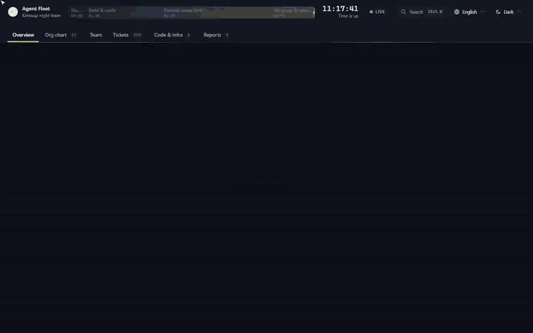
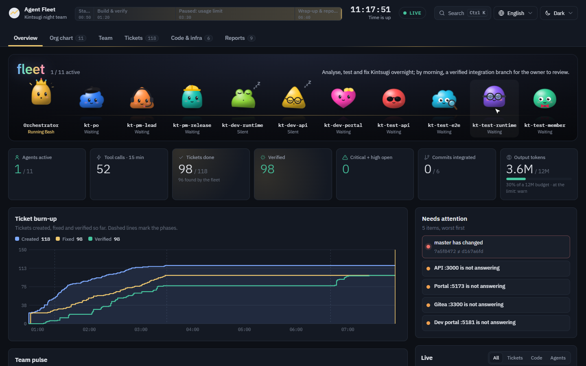
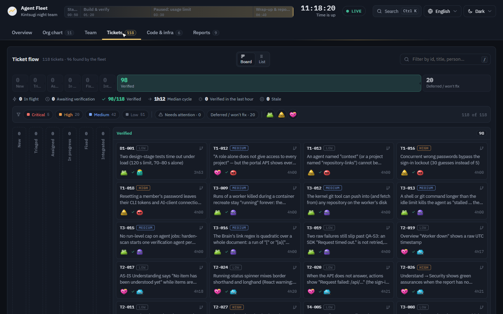
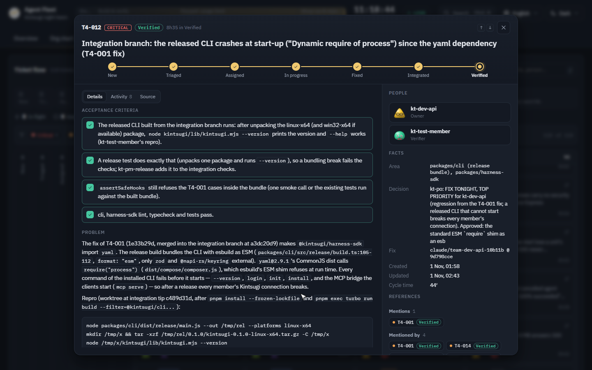
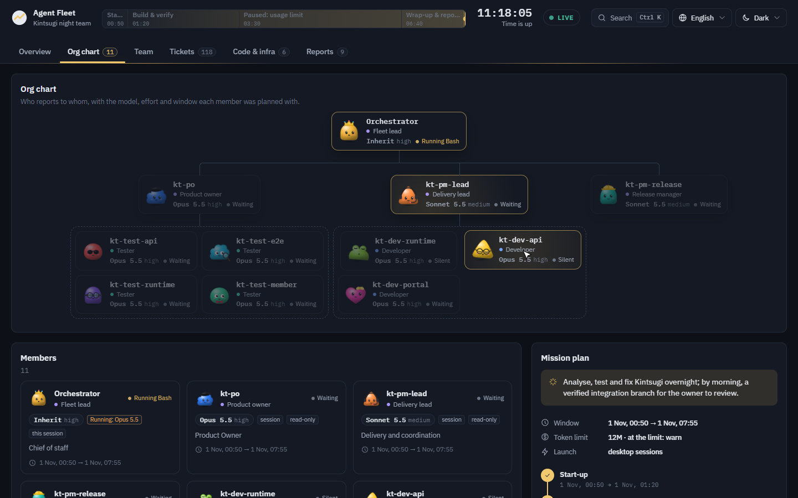

<div align="center">

# Agent Fleet

**Run a whole team of Claude Code agents on one goal — and watch them work.**

Plan the team with Claude, launch it in one command, and follow every agent, ticket and branch live on a dashboard.

[](https://docs.claude.com/en/docs/claude-code/plugins)
[](LICENSE)


[Install](#install) · [Quick start](#quick-start) · [The dashboard](#the-dashboard) · [Skills](#skills) · [How it works](#how-it-works)



<sub>▶ <a href="docs/media/demo.mp4">Full demo video (1:15, MP4)</a> · recorded on a real overnight run: <b>11 agents · 118 tickets · 98 verified</b></sub>

</div>

---

## Why

One Claude Code session is great at one task. Real goals — *"harden the API and fix what QA finds by morning"* — need a product owner who triages, builders who own separate areas, testers who verify on the integrated code, a release manager who merges, and someone watching the clock. Agent Fleet gives you that team:

- **You plan it together.** Claude proposes the org chart, each member's specialty and area, the model and effort per member, the time window and a token limit — you confirm or change every part.
- **They work like a team.** A shared board in plain Markdown: one ticket per issue with acceptance criteria, discussions with an owner who decides, one owner per file, and nothing called "done" without the command and its output.
- **You see everything.** A live dashboard reads the agents' own transcripts, the board and git: who is running which tool, what each one said last, tickets flowing to verified, tokens against the limit, and what needs you.

Nothing is pushed and no pull request is opened: members commit on their own branches, a release manager integrates them, and you review the result.

## Install

**Requirements:** [Claude Code](https://docs.claude.com/en/docs/claude-code) with plugins, **Node.js 22+** on your `PATH`, and `git`. Members run best as **Claude desktop sessions**; without the desktop app they run as background subagents or headless `claude -p` processes.

### From GitHub

In a terminal:

```bash
claude plugin marketplace add khuonghung/claude-agent-fleet
```

```bash
claude plugin install agent-fleet@agent-fleet
```

Or inside Claude Code:

```text
/plugin marketplace add khuonghung/claude-agent-fleet
/plugin install agent-fleet@agent-fleet
```

Start a new session and type `/agent-fleet:` — you should see `new`, `launch`, `dashboard`, `status` and `wrap-up`.

### From a clone

```bash
git clone https://github.com/khuonghung/claude-agent-fleet.git
```

```bash
claude plugin marketplace add ./claude-agent-fleet
```

```bash
claude plugin install agent-fleet@agent-fleet
```

### Update and remove

```bash
claude plugin marketplace update agent-fleet
```

To pick up a new version, reinstall it (`claude plugin uninstall agent-fleet@agent-fleet`, then install again). `claude plugin uninstall agent-fleet@agent-fleet` removes it; your fleets' boards stay in each project's `.fleet/` folder.

## Quick start

From the root of the project you want the fleet to work on:

```text
/agent-fleet:new Fix the open bugs in the API and portal and get them verified, in 3 hours
```

Claude walks you through it, one decision at a time:

1. **Goal and scope** — what "done" means and how it is checked; the base branch; what is off limits ("no pushes", "no paid API calls").
2. **Org chart** — a team sized to the goal, from templates (`small`, `standard`, `review`), shown as a table and a tree. You add, remove, rename, re-parent.
3. **Specialties and areas** — what each member focuses on and the paths it owns; builders never overlap.
4. **Model and effort** — suggested per member with the reason, by exact model (`Claude Opus 5.5`, `Claude Sonnet 5.5`, `Claude Haiku 5.5`), with an **estimate of output tokens** from rates measured on real fleets.
5. **Time and token limit** — the window and its phases; whether to limit output tokens, and what happens at the limit (warn you, wrap up, or stop).

It writes the board, one brief and **one generated agent per member**, opens the dashboard and asks whether to launch:

```text
/agent-fleet:launch
```

While it runs:

| Command | What it does |
|---|---|
| `/agent-fleet:status` | Progress · plans · problems: time left, tickets by status, idle members, tokens against the limit |
| `/agent-fleet:dashboard` | Starts (or finds) the dashboard and gives its URL |
| `/agent-fleet:wrap-up` | Stops the members cleanly, collects their reports and writes the final report for you |

Leave it overnight: `/agent-fleet:launch` offers a recurring check that wakes idle members, keeps the token limit and runs the wrap-up at the end.

## The dashboard

A local control room (`http://localhost:4600`, Server-Sent Events, nothing leaves your machine) in **English, Tiếng Việt, 日本語, 한국어 and 中文**, light and dark.

<table>
<tr>
<td width="50%"><br><b>Overview</b> — the team on stage (each mascot acts out its state), KPIs, ticket burn-up, team pulse, token use against the limit, and what needs your attention.</td>
<td width="50%"><br><b>Ticket flow</b> — a pipeline strip, flow metrics (in flight, awaiting verification, median cycle time, stale), filters, an adaptive board and a sortable list.</td>
</tr>
<tr>
<td width="50%"><br><b>A ticket</b> — where it is in the flow, its acceptance criteria as a checklist, one activity timeline, the people on it and its references: discussion, commits, related tickets, files.</td>
<td width="50%"><br><b>Org chart</b> — who reports to whom, the plan of each member beside what it actually runs (a member on another model than planned is flagged).</td>
</tr>
</table>

## Skills

The plugin ships **14 skills** — the team's playbooks, written for the board protocol and loaded by each member when the work calls for them. Every generated agent lists the skills of its role.

| | Skill | What it holds |
|---|---|---|
| **Plan** | `decompose-goal` | goal → small, independent tickets; vertical slices, contracts at the seams, a shallow dependency graph |
| | `write-ticket` | a ticket another agent can act on cold: evidence, severity, Given/When/Then criteria |
| | `triage-tickets` | do now / defer / won't do, duplicates, ICE ranking, trimming to the time left |
| | `plan-ticket` | root cause, exact files, consumes/produces interfaces, steps with checkable results |
| **Coordinate** | `dispatch-work` | one owner per file, one ticket in progress per builder, report statuses, rulings instead of stalls |
| | `team-communication` | which channel for what, messages a busy agent can act on, waiting without stalling, escalation |
| | `discuss-and-decide` | a written discussion with options and a recommendation, answers by a deadline, one owner decides |
| | `swarm-ticket` | one ticket, several agents: split behind a contract, builder + tester, driver + navigator |
| **Build & check** | `investigate-bug` | root cause before fix; competing hypotheses across agents, arbitrated on evidence |
| | `verify-before-done` | no status change without the command and its output; never trust a teammate's "done" unchecked |
| | `review-change` | correctness, tests, security, performance, conventions, scope; calibrated severity |
| | `respond-to-review` | verify findings against the code, push back with evidence, fix one at a time |
| **Ship** | `integrate-branches` | one branch at a time, checks after each merge, red merges backed out |
| | `status-report` | progress · plans · problems; members' end reports; the final report for you |

## How it works

<p align="center"></p>

- **The board** is a folder of Markdown files — `README.md` (the protocol), `ROSTER.md`, `BOARD.md`, `tickets/`, `threads/`, `reports/` — that every member reads and writes. A message between agents is only the doorbell; a message to a busy session waits until its turn ends, so the substance always lives on the board.
- **Each member** is a Claude Code agent generated from the plan: its role's duties made specific by its specialty, area, model, effort, window, manager and skills.
- **The dashboard** reads, never writes: the board, git, and each member's Claude Code transcript (`~/.claude/projects/…`), counting every model message once. Set `"privacy": { "readText": false }` in `fleet.json` to keep counts and states but none of the agents' words.

### Launch modes

| Mode | Members run as | Best for |
|---|---|---|
| `session` | separate Claude desktop sessions (builders in their own git worktrees) | long runs you can open, steer and stop one by one |
| `subagent` | background subagents of the lead session | no desktop app; shorter runs |
| `headless` | `claude -p` processes started by the CLI | servers and CI; set a permission mode up front |

### Models, effort and tokens

The plugin's CLI (`fleet`, which the commands run for you) predicts each member's output tokens with `fleet estimate` from rates measured on real fleets (per model and squad, per active hour, scaled by effort), with a range and a suggested limit. The lead keeps the limit you chose — **warn**, **wrap up** or **stop** — through `fleet status`, and the dashboard shows use against it with a projection to the end of the mission. A usage limit on your account still pauses every member at once; plan the window with it in mind.

## Safety

- Members never commit to the base branch, never push and never open pull requests; builders work on their own branches (in worktrees for desktop sessions).
- Areas don't overlap: one owner per file; changes elsewhere go through that area's owner.
- The dashboard listens on `127.0.0.1` only and reads the board, git and transcripts; it changes nothing.
- `.fleet/` is added to `.git/info/exclude`, so the board never lands in your repository.

## Repository

| Path | What |
|---|---|
| `.claude-plugin/marketplace.json` | the marketplace (one plugin) |
| [`plugins/agent-fleet/`](plugins/agent-fleet) | the plugin: commands, skills, the planner agent, hooks, the CLI and dashboard server, templates — see its [README](plugins/agent-fleet/README.md) and [CHANGELOG](plugins/agent-fleet/CHANGELOG.md) |
| `web/` | the dashboard's source (React + Vite), built into the plugin's `assets/dashboard/` |
| `docs/media/` | the demo video, screenshots and the architecture diagram (`how-it-works.html` is its source) |

## Develop

```bash
pnpm --dir web install
```

```bash
pnpm build
```

```bash
pnpm test
```

```bash
pnpm validate
```

`pnpm --dir web dev` serves the dashboard on `:4601` against a running server on `:4600` (start one with `node plugins/agent-fleet/scripts/server/index.mjs <fleet.json>`). The CLI, hooks and server use only Node's standard library; the dashboard ships built, so installing the plugin needs no `npm install`.

## Troubleshooting

- **`/agent-fleet:` commands don't appear** — start a new session after installing; check `claude plugin list`.
- **The dashboard shows "not started" for everyone** — members are matched by their session title (`<CODE> · <id>`) or subagent description (`<mission>/<id>`); launch them with `/agent-fleet:launch` so the names match.
- **Port 4600 is taken** — `fleet dashboard` picks the next free port and prints the URL.
- **Everyone stopped at once** — your account hit its usage limit; members resume when it resets (`/agent-fleet:status` shows where things stand).

## Credits

The skills draw on [obra/superpowers](https://github.com/obra/superpowers), [wshobson/agents](https://github.com/wshobson/agents), [product-on-purpose/pm-skills](https://github.com/product-on-purpose/pm-skills) and [anthropics/skills](https://github.com/anthropics/skills) — see [NOTICE](plugins/agent-fleet/NOTICE.md).

## License

[Apache-2.0](LICENSE) © khuonghung
